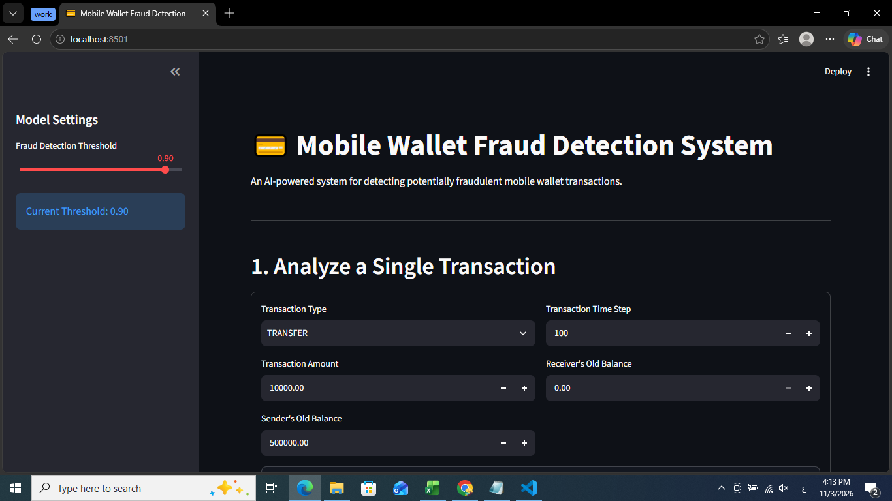

# AEGIS | Mobile Wallet Fraud Detection

**An AI-powered fraud detection system for mobile wallet transactions using Machine Learning and Streamlit.**

AEGIS is a machine learning project designed to detect potentially fraudulent mobile wallet transactions using the PaySim synthetic financial dataset. The system uses a trained Random Forest classification pipeline to evaluate transactions and identify suspicious activity.

The project focuses on building a practical fraud detection workflow, from data understanding and model development to evaluation, model deployment, and interactive prediction.

---

## Project Overview

Financial fraud detection is a challenging classification problem because fraudulent transactions represent only a small proportion of total transactions.

AEGIS addresses this challenge by applying machine learning techniques to identify suspicious transactions while balancing fraud detection performance and false alarms.

## Project Context

This project was developed as part of the Machine Learning program at **NextGen Institute**, applying practical machine learning concepts to a real-world FinTech problem.

The project demonstrates the application of data analysis, feature engineering, model development, hyperparameter tuning, evaluation, and deployment in an end-to-end fraud detection workflow.

**Key objectives:**
- Analyze mobile wallet transaction patterns.
- Identify important indicators of fraudulent behavior.
- Train and evaluate machine learning models.
- Build a real-time-oriented fraud detection pipeline.
- Deploy an interactive application for individual and batch predictions.

---

## Dataset

The project uses the **PaySim Mobile Money Dataset**, a synthetic dataset that simulates mobile money transactions.

The original dataset is not included in this repository because of its large file size.
https://www.kaggle.com/datasets/ealaxi/paysim1

---

## Machine Learning Approach

The final deployed model is a **Random Forest Classifier** integrated into a Scikit-learn Pipeline.

### Real-Time Feature Selection

To make the prediction process suitable for pre-transaction fraud assessment, the final model uses five features that are available before a transaction is completed:

| Feature | Description |
|---|---|
| `step` | Time step of the transaction |
| `type` | Transaction type |
| `amount` | Transaction amount |
| `oldbalanceOrg` | Origin account balance before transaction |
| `oldbalanceDest` | Destination account balance before transaction |

Post-transaction balance features were excluded from the final real-time model to avoid relying on information that would not be available at decision time.

### Model Configuration

- Algorithm: Random Forest Classifier
- Architecture: Scikit-learn Pipeline
- Decision Threshold: 0.90
- Task: Binary Classification

---

## Model Performance

The final real-time model achieved the following results on the test set:

| Metric | Result |
|---|---:|
| Precision | 89.39% |
| Recall | 60.50% |
| F1-Score | 72.05% |
| Average Precision (AP) | 0.7424 |

These metrics reflect the model's performance at the selected decision threshold of 0.90.

---

## Streamlit Application

AEGIS includes an interactive Streamlit application that allows users to:

- Enter individual transaction details.
- Evaluate transactions for potential fraud.
- Upload a CSV file for batch prediction.
- Review prediction results through an interactive interface.
  
  https://aegis-mobile-wallet-fraud-detection.streamlit.app/
### Application Preview


---

## Project Structure

```text
AEGIS-Mobile-Wallet-Fraud-Detection/
│
├── 01_Data_Understanding.ipynb
├── app.py
├── requirements.txt
├── sample_transactions.csv
│
├── models/
│   └── fraud_detection_pipeline.joblib
│
├── screenshots/
│   └── app_screenshot.png
│
└── .gitignore
```

---

## Installation and Usage

### 1. Clone the Repository

```bash
git clone https://github.com/NadineAkram/AEGIS-Mobile-Wallet-Fraud-Detection.git
cd AEGIS-Mobile-Wallet-Fraud-Detection
```

### 2. Create a Virtual Environment

```bash
python -m venv .venv
```

Activate it:

**Windows:**
```bash
.venv\Scripts\activate
```

**macOS / Linux:**
```bash
source .venv/bin/activate
```

### 3. Install Dependencies

```bash
pip install -r requirements.txt
```

### 4. Run the Application

```bash
streamlit run app.py
```

The application will open in your browser.

---

## Technologies Used

- Python
- Pandas
- NumPy
- Scikit-learn
- Random Forest
- Streamlit
- Joblib
- Jupyter Notebook
- Git & GitHub

---

## Future Improvements

- Experiment with additional fraud detection algorithms.
- Improve fraud recall while maintaining acceptable precision.
- Integrate real-time transaction data streams.
- Add explainable AI techniques for prediction interpretation.
- Explore deployment and model monitoring solutions.

---

## Author

**Nadine Akram**

Communications and Electronics Engineer
**Project:** AEGIS – Mobile Wallet Fraud Detection

[GitHub Profile](https://github.com/NadineAkram)

---

*AEGIS is an educational and portfolio project developed for machine learning and fraud detection experimentation. Predictions should not be treated as definitive financial fraud decisions.*
